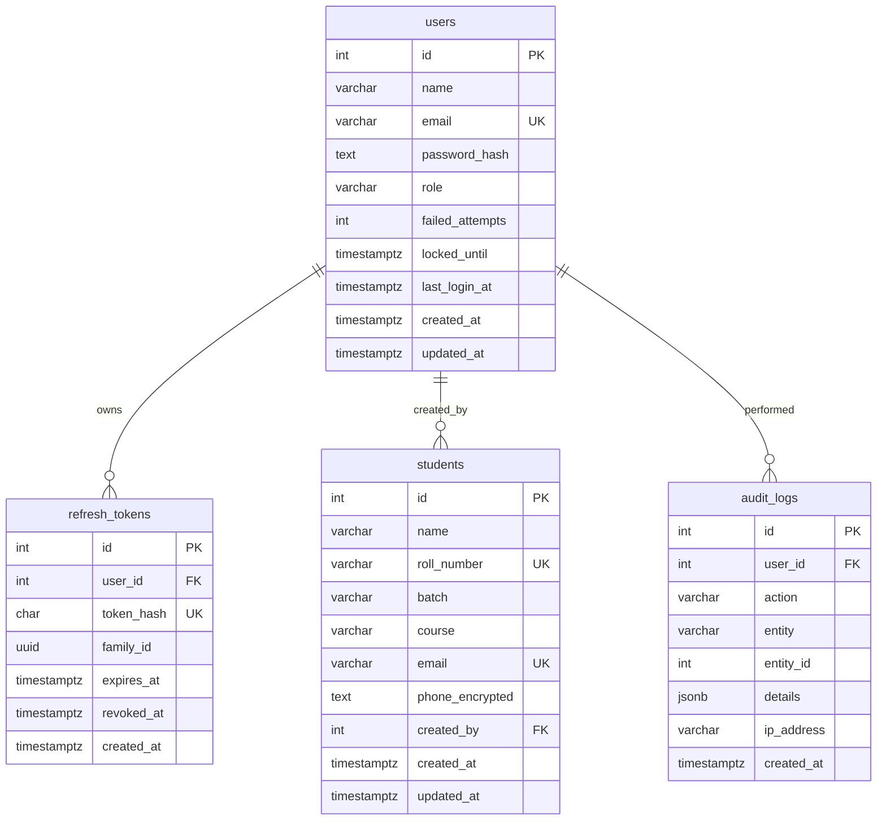

# Database Design

PostgreSQL 16. All access goes through parameterised queries in `backend/src/models`. The schema is created by the versioned SQL files in `backend/src/db/migrations`, applied in order and recorded in the `schema_migrations` table.

## Entity relationship diagram



## Tables

### users
Accounts that can sign in to the portal.

| Column | Type | Notes |
| --- | --- | --- |
| id | integer identity | primary key |
| name | varchar(100) | required |
| email | varchar(255) | required, unique case-insensitively through `lower(email)` |
| password_hash | text | bcrypt hash, never the plain password |
| role | varchar(10) | `admin` or `staff`, enforced by a CHECK constraint |
| failed_attempts | integer | consecutive failed logins, reset on success or lock |
| locked_until | timestamptz | set for 15 minutes after 5 failed logins |
| last_login_at | timestamptz | updated on successful login |

### refresh_tokens
Server-side record of issued refresh tokens. Only the SHA-256 hash of the token is stored, so a database leak does not expose usable tokens.

| Column | Type | Notes |
| --- | --- | --- |
| token_hash | char(64) | unique |
| family_id | uuid | all tokens descended from one login share a family |
| expires_at | timestamptz | default lifetime 7 days |
| revoked_at | timestamptz | set when rotated, logged out, or when reuse is detected |

Rotation: every refresh revokes the presented token and issues a new one in the same family. Presenting an already revoked token revokes the entire family, which signs out a thief and the legitimate user alike.

### students
The core resource.

| Column | Type | Notes |
| --- | --- | --- |
| id | integer identity | primary key |
| name | varchar(100) | required |
| roll_number | varchar(30) | required, unique case-insensitively |
| batch | varchar(20) | required |
| course | varchar(80) | required |
| email | varchar(255) | required, unique case-insensitively |
| phone_encrypted | text | AES-256-GCM ciphertext, nullable |
| created_by | integer | references users, set to NULL if the user is deleted |

### audit_logs
Append-only history of sign-ins and student changes. `details` holds small JSON such as the roll number. Personal data such as emails or phone numbers is not copied into it.

## Indexes

| Index | Purpose |
| --- | --- |
| `users_email_lower_uidx` (unique) | case-insensitive login lookup and duplicate prevention |
| `students_roll_number_lower_uidx` (unique) | duplicate prevention |
| `students_email_lower_uidx` (unique) | duplicate prevention |
| `students_course_idx`, `students_batch_idx` | course and batch filters and the dashboard distinct counts |
| `refresh_tokens_user_idx`, `refresh_tokens_family_idx` | revoking by user or family |
| `refresh_tokens.token_hash` (unique) | token lookup on every refresh |
| `audit_logs_created_idx` | newest-first listing |

## Design decisions

- **Normalisation.** Each fact is stored once. Users, students, tokens and audit entries are separate tables linked by foreign keys. Course and batch are kept as plain text on the student because the portal needs no extra attributes for them. If courses later gain their own data (fees, duration), they would move to a `courses` table referenced by a foreign key.
- **Integrity in the database, not only in code.** Uniqueness, the role check and foreign keys are enforced by PostgreSQL, so a bug in the API cannot create duplicates. The API translates the resulting unique violations into HTTP 409.
- **Cascades.** Deleting a user removes their refresh tokens. Students and audit entries survive and lose only the pointer to the user (`ON DELETE SET NULL`).
- **Sensitive data.** Passwords are bcrypt hashed. Phone numbers are encrypted at the application layer with AES-256-GCM using a key derived from `DATA_ENCRYPTION_KEY`, so they are unreadable in database dumps and backups. Each value uses a fresh random IV and an authentication tag, which detects tampering. Encrypted columns cannot be searched, which is why the phone is not used in search.
- **Identity columns** use `GENERATED ALWAYS AS IDENTITY` rather than `SERIAL`, the current PostgreSQL recommendation.
- **Timestamps** use `timestamptz` so values are unambiguous across time zones.

## Migrations

Add a new file such as `002_add_something.sql` to `backend/src/db/migrations`. On startup (or with `npm run migrate`) any file not yet listed in `schema_migrations` runs inside a transaction. A failed migration rolls back and stops the server from starting. An advisory lock prevents two instances from migrating at the same time.

## Useful queries

```sql
-- Students per course
SELECT course, COUNT(*) FROM students GROUP BY course ORDER BY COUNT(*) DESC;

-- Recent activity
SELECT created_at, action, entity, entity_id FROM audit_logs ORDER BY id DESC LIMIT 20;

-- Confirm phone numbers are not stored in plain text
SELECT id, left(phone_encrypted, 20) FROM students WHERE phone_encrypted IS NOT NULL;
```

## Backups

Use `pg_dump` on the database. Keep `DATA_ENCRYPTION_KEY` backed up separately and securely: without it, the encrypted phone numbers in a restored dump cannot be read.
